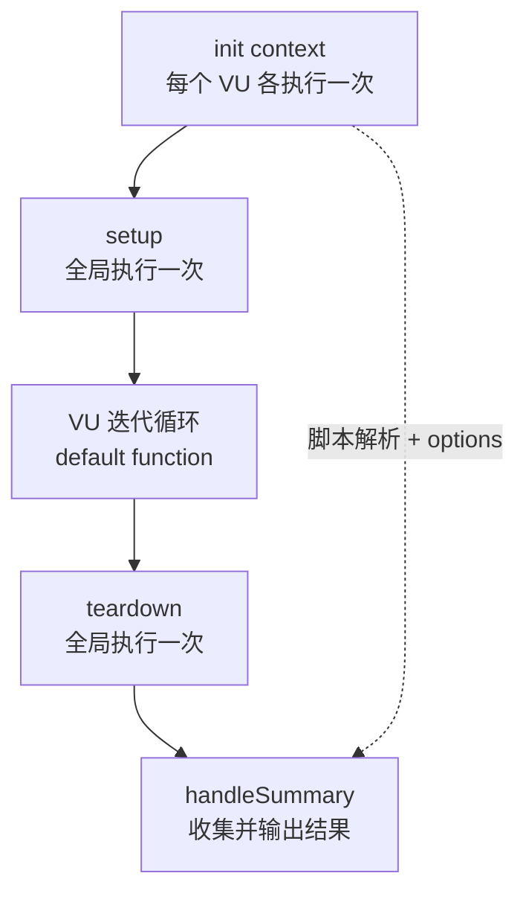
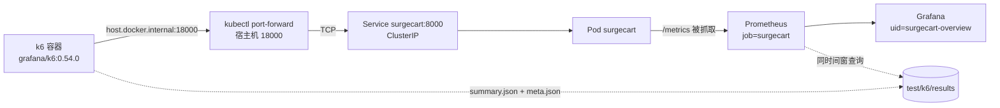
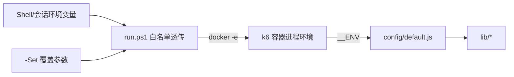
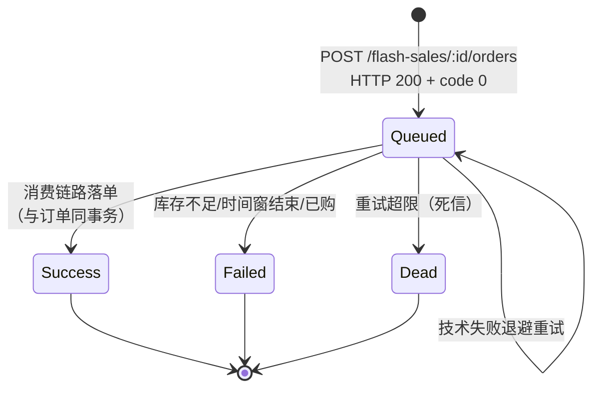

# T5-01 开发知识文档：测试方案与 k6 测试框架

> 本文档记录 T5-01 的真实开发过程：为什么这样设计、踩了哪些坑、怎么定位、最终如何验证。
> 所有结论都对应仓库中真实存在的文件；所有测试数字都来自真实执行，未执行的部分明确标注。
> 本文档不含任何凭据取值。

- 分支：`feat/k8s-t5-01-k6-test-framework`
- 基线：`feat/k8s-t4-04-grafana-dashboard` @ `0062c4a5a5da2b637967591988b4bfde246d1d58`
- 被测镜像：`surgecart:64ebbbd-t4-03`（集群内实际运行）
- 集群：kind `kind-surgecart-local`，`FLASH_SALE_DISPATCH_MODE=kafka`，`FLASH_SALE_METRICS_ENABLED=true`

---

## 1. 背景与目标

SurgeCart 已完成 Kafka 秒杀改造、Kubernetes 适配、监控体系（T4-01~T4-04）。任务五要做
性能与可靠性实验，但在此之前必须先回答一个更基础的问题：**实验怎么做才算数**。

T5-01 的目标不是产出 QPS，而是产出一套能支撑后续三个实验的基础设施：

1. 从本机向集群内的 SurgeCart 产生测试流量；
2. 统一管理测试环境与参数；
3. 可复用的测试脚本结构；
4. 独立的测试用户/商品/SKU/秒杀活动数据；
5. 区分「HTTP 请求成功」与「真正的业务成功」；
6. 保存原始结果；
7. 把 k6 结果与 Prometheus/Grafana 指标对上；
8. 可重复执行且不污染正常业务数据。

非目标（本任务明确不做）：正式负载测试、db_scanner 与 kafka 的吞吐对比、高并发秒杀、
Kafka 积压与故障注入、任何业务代码/配置/Dashboard 修改。

---

## 2. k6 的基本工作机制

k6 是 Go 实现的负载测试工具，但脚本用 JavaScript 写。理解它的运行模型是理解本框架
所有设计取舍的前提。

### 2.1 三层执行模型



- **init context**：脚本顶层代码。每个 VU 的运行时都会重新执行一次，因此这里**不能**发请求、
  不能做有副作用的操作。`options`、`open()`、常量、配置解析放这里。
- **setup**：只执行一次，返回值通过 `default(data)` 传给所有 VU（会被序列化）。
  适合「一次性准备」：登录管理员、建测试数据、批量注册测试用户。
- **default function**：每个 VU 反复执行的「一次迭代」，是真正的负载。
- **teardown / handleSummary**：结束后收尾与输出。

关键结论（直接影响本框架）：

1. 顶层 `console.log` 会打印 N 次（N≈VU 实例数），所以配置日志重复是正常现象；
2. `setup()` 里放业务前置条件校验，可以让 `k6 inspect` 静态检查不受业务参数影响；
3. `handleSummary` 拿不到 `setup()` 的返回值（运行在不同运行时），所以测试数据 ID
   必须由外部（runner）落盘。

### 2.2 VU、迭代与 RPS 的关系

k6 的 `stages: [{duration, target}]` 控制的是**虚拟用户数**，不是 RPS：

```text
RPS ≈ VU 数 / 单次迭代耗时
```

单次迭代耗时 = 请求耗时之和 + `sleep()`。因此「想压到 100 RPS」不是一个可以直接配置的值，
而是「VU 数 × 单 VU 每秒迭代数」。这也是为什么本框架在 `read-load.js` 里保留
`THINK_TIME_MS`：不加思考时间，VU 会以纯忙等方式循环，真实用户不会这样。

每个 VU 是独立的 JS 运行时（独立 `http` 连接池、独立模块状态）。因此：
- 客户端 token 天然按 VU 隔离，不需要加锁；
- 1000 个 VU 就有 1000 份脚本运行时，内存开销随 VU 线性增长；
- `setup()` 顺序执行的耗时（如 bcrypt 注册）不受 VU 数并行化。

### 2.3 为什么用 Docker 跑 k6

宿主机是 Windows 11，未安装 k6。可选方案：

| 方案 | 评价 |
|---|---|
| 用 winget/choco 安装 | 修改系统级环境，违反本任务「不得擅自修改系统环境」 |
| 编译 Go 源码 | k6 不是纯 Go 依赖，构建链复杂，收益低 |
| 官方镜像 `grafana/k6` | 零安装、版本固定、可复现 → **采用** |

代价：容器网络与宿主机不同。容器里的 `127.0.0.1` 是容器自己，访问宿主机必须用
`host.docker.internal`（Docker Desktop 提供）。这一点在动手前就实测确认过：

```text
docker run --rm -i -v probe.js:/scripts/probe.js grafana/k6:0.54.0 run /scripts/probe.js
→ http_req_duration avg=4.16ms, http_req_failed 0.00%
```

### 2.4 流量的完整路径



这条链路解释了后面所有「为什么」：为什么要 port-forward、为什么端口是 18000、
为什么客户端时延包含隧道开销、为什么服务端直方图才是应用自身耗时。

---

## 3. 为什么采用当前的框架结构

### 3.1 先调查，再动手

任务要求先做只读调查。调查得到的**决定性事实**：

| 调查项 | 结论 | 对设计的影响 |
|---|---|---|
| 现有测试资产 | `test/e2e`（Go 集成测试）、`test/deployk8s`、`scripts/flashsale-loadtest`（bash + curl 压测） | 不重复造；新框架放 `test/k6`，与 bash 压测并存（后者面向 docker-compose + MySQL 客户端） |
| 现有 k6 代码 | 无 | 需要从零建立 |
| 响应格式 | `{code,message,data}`，`/metrics` 例外 | HTTP 封装必须内建包解析与文本模式 |
| 路由 | 前台无版本前缀，后台 `/admin` 前缀 | `lib/endpoints.js` 逐条对照源码记录 |
| 秒杀契约 | 异步：`queued/success/failed/dead`，下单只返回受理 | 「HTTP 200 ≠ 业务成功」必须落成分类函数 |
| 指标 | `surgecart_*` / `flashsale_*`，已在真实 `/metrics` 中确认 | Smoke 按实际输出断言，不猜名字 |
| 服务暴露 | 仅 ClusterIP，无 NodePort/Ingress | 必须 port-forward |
| k6 | 未安装，Docker 可用 | 用官方镜像 |

### 3.2 目录结构决策

```text
test/k6/{config,lib,scenarios,tools,scripts,results,data}
```

- `config/` 与 `lib/` 分离：配置是**数据**（可被不同场景复用），lib 是**行为**。
- `scenarios/` 只做「编排」：调用 lib、声明 options、声明 check 与阈值。这样 T5-02 改的是
  options，不是请求逻辑。
- `tools/` 用于「非负载」的一次性动作（准备数据），与 `scenarios/` 分开，避免误把
  数据准备脚本当压测脚本执行。
- `results/` 与 `data/` 都是运行产物，`.gitignore` 排除，只留 `.gitkeep`。
- **没有** `fixtures/`、`utils/`、`helpers/` 这类空壳目录；也没有引入外部 npm 依赖
  （k6 不支持 npm 生态，引入会破坏离线可运行性）。

---

## 4. 各目录与文件职责

| 文件 | 职责 | 关键约束 |
|---|---|---|
| `config/default.js` | 环境变量 → 配置对象；`requireEnv`/`envInt`/`envBool`/`redact` | 敏感项无默认值；非法数字立刻失败 |
| `config/env.example` | 变量清单模板 | 不含真实凭据 |
| `lib/endpoints.js` | 路径 + 路由模板 | 动态路径必须给模板，防 tag 爆炸 |
| `lib/http.js` | 请求、超时、认证、tag、包解析、错误分类 | 不自动重试；不把 ID 放进 tag |
| `lib/auth.js` | 注册/登录测试用户、管理员登录、批量准备 | 密码只从环境变量读 |
| `lib/business.js` | 商品/SKU/秒杀/订单 API + 业务结果分类 | 业务码与状态枚举照抄 `codes.go` / `flash_sale.go` |
| `lib/metrics.js` | Prometheus 文本解析、指标族断言 | 只实现项目用到的子集 |
| `lib/stages.js` | 负载档位、阈值骨架 | 数值是**默认值**，不是容量结论 |
| `lib/report.js` | `handleSummary` → summary.json/txt | 不引入需要联网的 jslib |
| `scenarios/smoke.js` | 健康/就绪/指标三层巡检 | 1 VU、3 迭代、零副作用 |
| `scenarios/read-load.js` | 只读负载（T5-02 入口） | 未执行 |
| `scenarios/flashsale-order.js` | 秒杀下单（T5-03/04 入口） | 未执行；`FLASH_VERIFY` 会改变请求形状 |
| `tools/prepare-data.js` | 独立测试商品/SKU/活动 | 只走业务 API，不写库 |
| `scripts/run.ps1` | docker 执行 + 日志 + summary + meta | 白名单透传环境变量 |

---

## 5. 测试脚本如何执行

### 5.1 标准命令

```powershell
kubectl -n surgecart port-forward svc/surgecart 18000:8000
$env:EXPECT_DISPATCH_MODE = 'kafka'
powershell -ExecutionPolicy Bypass -File test/k6/scripts/run.ps1 `
  -Scenario smoke -RunId r20261110t040200 -BaseUrl http://host.docker.internal:18000
```

`run.ps1` 实际执行的 docker 命令（日志中可见，便于排查）：

```text
docker run --rm
  -v <repo>/test/k6:/scripts
  -v <repo>/test/k6/results:/results
  -v <repo>/test/k6/data:/data
  -w /scripts
  -e SURGECART_BASE_URL=... -e RUN_ID=... -e SCENARIO=... -e K6_SUMMARY_DIR=/results
  grafana/k6:0.54.0 run /scripts/scenarios/smoke.js
```

### 5.2 静态检查（不产生流量）

```powershell
docker run --rm -v "<repo>/test/k6:/scripts" -w /scripts grafana/k6:0.54.0 inspect /scripts/scenarios/read-load.js
```

`inspect` 会执行 init 上下文。这一点在设计时踩过坑（见 §11 问题 4）。

### 5.3 构建方式说明

本框架没有构建步骤：k6 直接解释 ES module 源码，`import` 相对路径即可。
好处是改脚本不用打包，坏处是没有类型检查——因此用 `k6 inspect` 当「静态门禁」。

---

## 6. 配置和测试数据如何传递

### 6.1 配置传递链



优先级：`-Set` > 环境变量 > 代码默认值。`run.ps1` 只透传固定白名单，避免把整个
宿主机环境（含无关凭据）灌进容器。

### 6.2 敏感信息

- `K6_TEST_PASSWORD`、`ADMIN_USERNAME`、`ADMIN_PASSWORD` 没有默认值，缺失即
  `requireEnv` 抛错；
- `printConfig` 用 `redact()` 把 `*password*|*secret*|*token*` 替换为 `***`；
- `meta.json` 的 `env` 字段过滤掉名字含 `PASSWORD` 的变量；
- 仓库里没有 `.env` 被提交，`test/k6/config/env.local` 也在 `.gitignore` 中。

### 6.3 测试数据传递

1. `tools/prepare-data.js` 在 `setup()` 中创建对象；
2. 它打印一行机器可读标记：
   `K6_DATA_MARKER {"run_id":...,"activity_id":12,"sku_id":57,...}`；
3. `run.ps1` 解析该行 → 写 `test/k6/data/<run_id>.data.json`；
4. 后续场景通过环境变量 `ACTIVITY_ID`/`SKU_ID`/`PRODUCT_ID` 接收。

为什么不用 `handleSummary` 写这个文件：`handleSummary` 只拿到 k6 指标，拿不到 setup 的
返回值（不同运行时）。为什么不用模块级变量传：同样跨运行时不可靠。显式标记行是
最小惊讶原则。

---

## 7. k6 如何产生虚拟用户和 HTTP 请求

### 7.1 VU 生命周期（以 smoke 为例）

```text
init: loadConfig() → options {vus:1, iterations:3}
  ↓
VU#1 建立运行时（独立 http 连接池、独立 copy of module state）
  ↓
迭代 1: GET /health → GET /ready → GET /metrics → 17 个 check
迭代 2: 同上
迭代 3: 同上
  ↓
handleSummary: 汇总 9 个 http_reqs、51 个 check
```

### 7.2 HTTP 封装做了什么

`lib/http.js::client.request` 的固定动作：

1. 拼接 `baseUrl + path`；
2. 注入 `timeout`（默认 5000ms，`/metrics` 放大到 10s）；
3. 注入 `Authorization: Bearer <token>`（有 token 时）；
4. 注入 tag：`name`（路由模板）、`scenario`、可选 `phase`；
5. 发请求 → 解析 `{code,message,data}`；
6. 分类计数：`k6_request_errors`（网络/超时/5xx）、`k6_envelope_errors`（结构异常）、
   `k6_business_rejected`（`code != 0`）。

### 7.3 连接复用

k6 默认每个 VU 复用 TCP 连接（keep-alive），因此 `http_req_blocked`/`connecting` 只在
首请求显著。smoke 的 `p95=6.1ms` 包含握手首次成本，样本只有 9 条，不具备统计意义。

---

## 8. 如何统计检查结果与错误

k6 内建指标 + 自定义指标的组合：

| 指标 | 类型 | 语义 |
|---|---|---|
| `checks` | Rate | 所有 `check()` 的通过率 |
| `http_reqs` | Counter | 请求总数 → RPS = `rate` |
| `http_req_duration` | Trend | 端到端耗时（含网络），P95 由 summary 计算 |
| `http_req_failed` | Rate | 本框架重定义了「预期状态码」集合（见下） |
| `k6_request_errors` | Counter | 真正的传输/服务端失败 |
| `k6_envelope_errors` | Counter | 契约漂移 |
| `k6_business_rejected` | Counter | 业务码非 0，按 `code` 打标签 |
| `k6_biz_outcomes` | Counter | 业务结论（`accepted`/`stock_insufficient`/…） |

### 8.1 为什么要重定义 `http_req_failed`

k6 默认把所有非 2xx/3xx 视为失败。但本项目的 409（库存不足）、429（限流）、
404（活动不存在）都是**正确的业务回答**。若沿用默认口径：

```text
高并发秒杀库存售罄 → 大量 409 → http_req_failed 看起来 30% → 误判为系统故障
```

因此 `lib/http.js` 用 `http.expectedStatuses(200,201,202,204,400,401,403,404,409,429,503)`
把业务状态码排除，再用 `k6_request_errors` 单独统计 5xx/超时/网络失败。代价是：
跨工具对比时不能直接拿 `http_req_failed` 跟别处的同名指标比较。

### 8.2 check 的命名约定

check 名称统一为 `<请求名> | <断言>`：

```text
GET /health | data.status=ok
GET /metrics | 必需指标族齐全
秒杀下单 | 响应包合法
```

这样 summary 里失败的 check 名本身就说明了「哪个接口的哪条契约坏了」。

---

## 9. 如何把测试结果与 Prometheus/Grafana 关联

### 9.1 关联的唯一桥梁：时间窗口

k6 的请求不打业务标签到服务端（不应该打，会造成高基数指标）。因此两侧只能靠
**时间窗口**对齐：

- `meta.json` 记录 `started_at_utc` / `finished_at_utc`（runner 写出，权威）；
- Prometheus 用 `query_range?start=<epoch>&end=<epoch>&step=15s` 查同一区间。

> 注意：`summary.json` 里的 `summary_exported_at` 只是导出时刻，**不能**当开始时间。
> 这是实测发现的问题（见 §11 问题 5）。

### 9.2 可用的 PromQL（与 Dashboard 一致）

```promql
sum by (route) (rate(surgecart_http_requests_total{job="surgecart"}[1m]))
histogram_quantile(0.95, sum by (le, route) (rate(surgecart_http_request_duration_seconds_bucket{job="surgecart"}[1m])))
sum(surgecart_http_requests_in_flight{job="surgecart"})
rate(process_cpu_seconds_total{job="surgecart"}[1m])
go_goroutines{job="surgecart"}
surgecart_kafka_consumer_lag{job="surgecart"}
flashsale_outbox_backlog_pending
surgecart_outbox_oldest_age_seconds
surgecart_sampler_up{job="surgecart"}
```

这些表达式与 Grafana Dashboard `uid=surgecart-overview` 的面板口径一致，
所以「看板上的曲线」与「报告里的数字」是同一事实源。

### 9.3 实测关联证据

Smoke 结束后查询：

```promql
sum by (route,status) (increase(surgecart_http_requests_total{job="surgecart"}[10m]))
```

返回 `/health`、`/ready`、`/products`、`/products/:id` 四条序列，
**没有 `route="/metrics"`**。这条阴性证据很重要：它证明 `/metrics` 抓取不会污染自身
指标（T4-02 的设计约束在真实运行中成立）。

同时要诚实说明其局限：`increase` 的数值里混有 kubelet 存活/就绪探针流量，
所以「数字变大」只能证明链路通，不能把增量直接当成 k6 的流量。

---

## 10. 如何区分请求吞吐量和业务成功吞吐量

这是本任务最重要的设计点。SurgeCart 秒杀是**异步受理**模型：



因此存在三个**不同**的吞吐：

| 口径 | 定义 | 指标 |
|---|---|---|
| 请求吞吐 | 单位时间受理的 HTTP 请求数 | `rate(surgecart_http_requests_total{route="/flash-sales/:id/orders"})` |
| 受理吞吐 | 单位时间成功进入队列的请求 | `rate(flashsale_requests_total{interface="order",result="queued"})` |
| 业务成功吞吐 | 单位时间真正成交的订单 | `rate(flashsale_requests_total{interface="consume",result="success"})` |

三者的差值本身是信息：请求吞吐高而受理吞吐低 → 闸门在拒绝（售罄/限流/已购）；
受理吞吐高而业务成功吞吐低 → 消费链路是瓶颈（这也是 T5-04 的核心观察点）。

在 k6 侧，`lib/business.js::classifyCreateOrder` 把响应映射为固定枚举，
`k6_biz_outcomes{operation="create_order",outcome="accepted"}` 只是「受理」，
**不能**当作「秒杀成功」。真正的成功必须由结果查询 `GET /flash-sales/:id/orders/result`
返回 `status=success` 且带 `order.id`，或以数据库 `flash_sale_orders` 行为准。

`classifyCreateOrder` 的完整分支（对应 `internal/codes/codes.go`）：

| 条件 | outcome |
|---|---|
| `code=0, status=queued` | `accepted` |
| `code=0, status=success/failed/dead` | `idempotent_replay_*`（幂等命中返回既有状态） |
| `12003` | `stock_insufficient` |
| `12004` | `already_purchased` |
| `12005` | `idempotency_conflict` |
| `12006` | `sku_unavailable` |
| `12002` / `12001` | `not_in_time_window` / `activity_not_found` |
| `12009` / `12010` | `rate_limited` / `queue_full` |
| `1005` / `1000` | `service_unavailable` / `internal_error` |

后两类（以及 `transport_error`）被归为 `AMBIGUOUS_OUTCOMES`：它们不代表业务结论，
是系统侧不确定性，必须单独统计，不能混进「秒杀失败」。

---

## 11. 开发过程中遇到的问题

下面每个问题都是真实发生的，按发生顺序排列。

### 问题 1：Windows 上 8000 端口无法绑定

**现象**：

```text
kubectl port-forward svc/surgecart 8000:8000
error: unable to listen on any of the requested ports: [{8000 8000}]
Unable to listen on port 8000: ... bind: An attempt was made to access a socket
in a way forbidden by its access permissions.
```

同时 `Get-NetTCPConnection -LocalPort 8000` 显示无人监听。

**定位过程**：
1. 先确认不是进程占用（无监听者）；
2. 换到 18000 立即可用；
3. 错误信息 "forbidden by its access permissions" 是 Windows 端口排除区间
   （Hyper-V/WinNAT 保留）的典型症状，而非权限不足。

**根因**：本地 8000 落在系统保留端口范围内，非管理员进程无法监听。

**解决**：文档与示例统一使用 `18000:8000`，通过 `-BaseUrl http://host.docker.internal:18000`
传入；`config/default.js` 仍以 8000 为默认（对应 Service 端口），并在 README 记录该限制。

### 问题 2：PowerShell 5.1 把中文注释读成乱码，脚本语法报错

**现象**：`run.ps1` 报一堆 `Unexpected token '{' in expression or statement`，
报错行号指向注释和字符串，且错误提示里中文显示为乱码。

**定位过程**：
1. 报错位置本身语法正确 → 怀疑编码；
2. 文件是 UTF-8 **无 BOM**；
3. Windows PowerShell 5.1 对无 BOM 的 `.ps1` 按系统 ANSI（本机 GBK）解码；
4. 中文字符被错误拆分成字节后，某些组合恰好构成引号/括号，导致解析器"看到"多余符号。

**根因**：PowerShell 5.1 默认编码与文件实际编码不一致。

**解决**：把 `run.ps1` 保存为 **UTF-8 with BOM**（`EF BB BF`）。
并在 README 已知限制里注明「修改该文件时保持 BOM」，避免将来被编辑器改回去。

### 问题 3：`$ErrorActionPreference='Stop'` 把 k6 的正常日志当成致命错误

**现象**：脚本打印完 `docker run ...` 命令后立即终止，报
`NativeCommandError`，但 docker 进程其实正常工作。

**定位过程**：
1. k6 的 `console.log` 走 **stderr**；
2. `& docker ... 2>&1` 把 stderr 变成 PowerShell 的 ErrorRecord；
3. `$ErrorActionPreference = 'Stop'` 下写错误流 = 终止错误。

**根因**：PowerShell 把「原生命令的 stderr」等同于「脚本错误」，与 Unix 语义不同。

**解决**：调用前后局部切换 `Continue`，并把输出统一 `ToString()`：

```powershell
$prevEap = $ErrorActionPreference
$ErrorActionPreference = 'Continue'
$rawOutput = & docker @dockerArgs 2>&1
$exitCode = $LASTEXITCODE
$ErrorActionPreference = $prevEap
```

### 问题 4：`k6 inspect` 因为业务参数缺失而失败

**现象**：`flashsale-order.js` 最初在 init 阶段校验 `ACTIVITY_ID`，结果
`k6 inspect` 直接抛错，静态检查无法进行。

**根因**：`inspect` 会执行 init 上下文，而 init 里的 `throw` 被当作脚本加载失败。

**解决**：init 阶段只读取（`envInt('ACTIVITY_ID', 0)`，缺省 0），
把「必须提供」的校验下沉到 `setup()`。副作用是正向的：静态检查随时可用，
而真实运行时仍然 fail-fast，并且失败发生在**发出任何业务请求之前**
（实测 `http_reqs=0`）。

### 问题 5：summary 里的「开始时间」不可信

**现象**：第一版 summary 出现 `started_at` 与 `finished_at` **完全相同**（精确到毫秒）。

**定位过程**：
1. 测试持续约 60ms，两个时间戳同毫秒理论上可能，但完全相同过于可疑；
2. 检查代码：`const STARTED_AT = new Date()` 是模块级常量；
3. 结论：`handleSummary` 运行时模块被重新初始化，常量被重新求值。

**根因**：k6 的 summary 阶段运行在独立运行时，模块级状态不会从 setup/迭代阶段继承。

**解决**：summary 只保留 `summary_exported_at` 与 `test_run_duration_ms`；
权威时间窗改由 `run.ps1` 在 docker 调用前后记录到 `meta.json`。
同一原因也解释了为什么测试数据 ID 不能通过 `handleSummary` 输出（见 §6.3）。

### 问题 6：验证静态检查时读到假的退出码

**现象**：批量 `docker run ... inspect` 后，脚本输出了 `exit=-1`，但 inspect 明明成功。

**根因**：在 PowerShell 管道中 `docker ... | Select-Object -First 6`，
`$LASTEXITCODE` 反映的不再是 docker 的退出码；同时 stderr 的 ErrorRecord 干扰判断。

**解决**：把 stdout/stderr 重定向到临时文件，读完再取 `$LASTEXITCODE`。
修正后 4 个脚本均为 `exit=0`。

### 问题 7（预防性，不是踩坑）：Kafka 指标在 db_scanner 模式下必然缺失

**背景**：`surgecart_kafka_consumer_lag`、`flashsale_outbox_backlog_pending`、
`surgecart_outbox_oldest_age_seconds` 只在 `dispatch_mode=kafka` 时才有序列
（Kafka Lag 采样器与 Outbox 采样器只在 Kafka 链路启动后运行）。

**决策**：smoke 不无条件要求这些指标族，而是按 `EXPECT_DISPATCH_MODE` 分级：
`kafka` 强制、`db_scanner` 仅记录、`unknown` 不断言。理由：用猜测的期望值判定失败，
会制造「环境切换就红」的假失败，久而久之没人再看 smoke 结果。

### 问题 8（预防性）：`padEnd` 的兼容性

k6 使用 Goja 作为 JS 引擎，ES2017 的 `String.prototype.padEnd` 覆盖不保证。
虽然未实际报错，但摘要输出不是关键路径也不值得赌，遂改为手写 `padRight`。
同理，`lib/report.js` 没有引入 `jslib.k6.io` 的 `k6-summary`——它需要联网 import，
离线环境会直接让「结果输出」这一步失败。

---

## 12. 问题定位方法论（可复用）

这些问题看起来各不相同，但定位路径一致：

1. **先分清层次**：是「我的脚本」「运行时/语言」还是「环境/系统」的问题？
   问题 1 是系统层（端口保留），问题 2/3 是语言运行时层（编码/错误流），
   问题 4/5 是 k6 执行模型层。
2. **用最小的可证伪实验**：换端口、加 BOM、打印 `$LASTEXITCODE`、
   用 `k6 inspect` 单独跑最小脚本。
3. **不要相信「看起来成功」**：问题 6 的 `exit=-1` 就是被管道掩盖的假信号；
   同理 summary 的时间戳被复用了也「看起来正常」。
4. **把结论写进代码注释**：本框架里凡是「反直觉」的地方（为什么提前返回、
   为什么不用 padEnd、为什么 summary 不写开始时间）都留了原因，避免后人"优化"回去。

---

## 13. 最终解决方案与技术决策

| 决策 | 选择 | 被放弃的方案 | 理由 |
|---|---|---|---|
| k6 运行方式 | Docker 官方镜像 | 本机安装 / 自编译 | 不改系统环境、版本可固定 |
| 访问路径 | port-forward + `host.docker.internal` | NodePort / Ingress | 现有 Service 是 ClusterIP，改集群超范围 |
| 配置来源 | 环境变量 | YAML/JSON 配置文件 | 与 k6 `__ENV` 天然契合，便于 CI 注入 |
| 结果格式 | 自绘 summary.json/txt | `--summary-export` / jslib | 离线可用、字段可控 |
| 原始结果 | 默认不导出，按需 `--out json` | 默认全量导出 | 体积大且无长期价值 |
| 业务成功判定 | 显式分类函数 + 结果查询 | 只看 HTTP 200 | 异步受理模型下 200 只代表"收下了" |
| HTTP 错误口径 | `expectedStatuses` + 自定义计数器 | 默认 k6 口径 | 业务 4xx 不应污染错误率 |
| 测试数据 | 业务 API 创建（`prepare-data.js`） | 直接 SQL 造数 | 不绕过校验、不受 schema 变更影响 |
| 数据隔离 | `DATA_PREFIX + runHash` | 每次清库重置 | 清库属破坏性操作，禁止 |
| 失败处理 | 配置/环境错误 fail-fast | 重试/降级 | 测试框架重试会掩盖真实失败率 |

---

## 14. 测试结果与验证证据

### 14.1 环境（实测）

| 项 | 值 |
|---|---|
| OS | Windows 11 |
| Docker | 29.9.3 |
| kubectl | v1.36.1 |
| 集群 | kind `kind-surgecart-local`，node v1.37.0（16h） |
| 应用镜像 | `surgecart:64ebbbd-t4-03` |
| dispatch_mode | `kafka`（ConfigMap） |
| metrics | `FLASH_SALE_METRICS_ENABLED=true` |
| Prometheus | `monitoring/prometheus` ClusterIP 9090，`job=surgecart` |
| Grafana | `monitoring/grafana`，dashboard uid `surgecart-overview` |
| k6 | `grafana/k6:0.54.0`（容器内 `k6 v0.54.0 ... linux/amd64`） |

### 14.2 静态检查（4/4 通过）

| 脚本 | 命令 | 结果 |
|---|---|---|
| `scenarios/smoke.js` | `k6 inspect` | exit=0 |
| `scenarios/read-load.js` | `k6 inspect` | exit=0 |
| `scenarios/flashsale-order.js` | `k6 inspect` | exit=0 |
| `tools/prepare-data.js` | `k6 inspect` | exit=0 |

### 14.3 Smoke 真实执行（VERIFIED）

- `run_id`：`r20261110t040200`
- 命令：见 §5.1
- 结果：

```text
checks            : rate=1.0000 passes=51 fails=0
http_reqs         : count=9
http_req_duration : avg=4.44ms med=4.61ms p(90)=5.94ms p(95)=6.11ms max=6.28ms
k6_request_errors : count=0
k6_envelope_errors: count=0
duration_ms       : 60.2
PASS checks rate==1
PASS k6_request_errors count==0
PASS k6_envelope_errors count==0
```

**解读边界**：51 个 check 证明「链路 + 契约 + 指标族」可用；9 个请求**不构成**任何
吞吐或容量结论。

### 14.4 配置缺失的错误处理（VERIFIED）

| 场景 | 触发 | 结果 |
|---|---|---|
| 秒杀场景缺 `ACTIVITY_ID` | `setup()` 首行 | exit=107，错误信息指明变量与用途，`http_reqs=0` |
| 数据准备缺 `ADMIN_USERNAME` | `loginAdmin → requireEnv` | exit=107，错误信息指明变量与用途，未发出任何请求 |

### 14.5 结果输出（VERIFIED）

`test/k6/results/` 实际产生：

```text
r20261110t040200.k6.log       1649 B
r20261110t040200.meta.json     948 B
r20261110t040200.summary.json 3540 B
r20261110t040200.summary.txt   791 B
```

`meta.json` 关键字段实测值：`git_sha=0062c4a5...`、`git_dirty=true`、
`kube_context=kind-surgecart-local`、`app_image=surgecart:64ebbbd-t4-03`。

### 14.6 监控关联（PARTIALLY VERIFIED）

`sum by (route,status) (increase(surgecart_http_requests_total{job="surgecart"}[10m]))`
返回 `/health`、`/ready`、`/products`、`/products/:id`，无 `route="/metrics"`。
证明：
- 服务端指标可查、与 k6 时间窗可对齐；
- `/metrics` 抓取未被自身统计。

未验证部分：由于本地探针流量混入，未做「纯 k6 流量」的精确归因，
该工作留到 T5-02（需静置窗口 + 前后差值法）。

---

## 15. 已知限制与未验证事项

| 项 | 状态 | 说明 |
|---|---|---|
| Smoke 真实执行 | VERIFIED | 见 §14.3 |
| 脚本静态检查 | VERIFIED | 4/4 exit=0 |
| 配置缺失处理 | VERIFIED | exit=107 |
| 结果文件输出 | VERIFIED | summary/meta/log |
| 监控关联 | PARTIALLY_VERIFIED | 指标可查，精确归因未做 |
| `read-load.js` 执行 | NOT_VERIFIED | 属 T5-02，本任务禁止执行负载 |
| `flashsale-order.js` 执行 | NOT_VERIFIED | 属 T5-03/04，本任务禁止 |
| `prepare-data.js` 执行 | NOT_VERIFIED | 无管理员凭据，且禁止读取 `.env`/Secret |
| 测试数据一致性 SQL | NOT_VERIFIED | 同上 |
| port-forward 作为客户端瓶颈 | 已知限制 | 高 VU 时隧道本身成为瓶颈，T5-02 需评估集群内运行 k6 |
| k6 版本 | 固定 0.54.0 | 升级需重新验证 |

---

## 16. T5-02 / T5-03 / T5-04 使用本框架的注意事项

### T5-02（负载与性能）
1. 先跑 `prepare-data.js`（需要管理员凭据），拿到 `PRODUCT_ID/ACTIVITY_ID/SKU_ID`；
2. `lib/stages.js` 的档位是**默认值**，必须按本机 CPU/内存调整后再定稿；
3. 高 VU 前先评估 port-forward 瓶颈：客户端 `http_reqs.rate` 上不去而服务端 CPU 很低，
   通常是被隧道限制，而不是应用到顶；
4. 切 `db_scanner`/`kafka` 属于部署动作（改 ConfigMap + 重启），需要在每次切换后
   记录 `meta.json` 的 `git_sha` 与 `app_image`，否则两次结果无法对比；
5. 每档结束后不要立刻删除结果，先确认 `k6_request_errors=0`，否则该档无效。

### T5-03（业务正确性）
1. 必须用独立活动（`prepare-data.js` 产出），**禁止**用正常业务活动；
2. 固定 `RUN_ID` + 固定 `K6_TEST_PASSWORD` 可复用已注册用户（命中 2001 分支），
   避免每次 bcrypt 注册上千用户；
3. `FLASH_VERIFY=true` 会追加结果查询，改变请求形状——只在低并发正确性场景用；
4. `FLASH_IDEMPOTENCY_REPLAY=true` 用于验证幂等；注意幂等键作用域是
   `user_id + idempotency_key`（全局，跨活动）；
5. 结论必须有 SQL 证据（README §5.4 六条查询），接口返回只是视图。

### T5-04（故障恢复）
1. 用 `tags.phase` 标记故障前/中/后（框架已支持 `phase` tag），否则结果混在一起无法归因；
2. 观察 `surgecart_kafka_consumer_lag` 时必须同时看 `surgecart_sampler_up`，
   采样失败时 Gauge 保留旧值，会把「采不到」误读成「积压没变」；
3. `dead` 状态必须能用 `fail_code` 解释，否则视为待修复缺陷；
4. 不要用 `increase` 判断恢复：积压是 Gauge，要看回落曲线与 `queued` 计数收敛。

---

## 17. 可能涉及的技术面试问题

**k6 / 负载测试**
1. k6 的 VU 是什么？为什么 `stages` 配的是 VU 而不是 RPS？怎么从 VU 推算 RPS？
2. k6 的 init / setup / default / teardown / handleSummary 分别在什么时机执行？
   哪些阶段不能发请求？为什么？
3. 为什么 k6 脚本里不能把 `user_id` 放进请求 tag？会导致什么后果？
4. k6 的 `http_req_failed` 默认口径是什么？为什么本项目要重定义？
5. 单机压测时，客户端成为瓶颈的信号有哪些？如何排除？

**测试设计**
6. 「HTTP 200 等于成功吗？」——结合本项目的异步秒杀受理模型说明。
7. 请求吞吐、受理吞吐、业务成功吞吐三者的差别，以及差值分别说明什么。
8. 如何设计不污染生产数据的压测数据方案？（前缀隔离、独立活动、不清库）
9. 为什么不能用 `increase(...)` 直接当压测流量？探针/后台流量如何影响？
10. 冒烟测试与负载测试的边界在哪里？冒烟通过能说明什么、不能说明什么？

**可观测性**
11. Prometheus 的 Counter/Gauge/Histogram 各适合什么？为什么 HTTP 耗时用 Histogram？
12. 标签基数（cardinality）爆炸是怎么发生的？本项目如何避免？
13. 为什么 `/metrics` 端点必须排除在自身 HTTP 指标之外？
14. 采样型指标（Kafka Lag、Outbox 积压）为什么需要 `sampler_up`？采样失败时为什么
    不能写 0？

**分布式系统**
15. 秒杀异步受理模型里，`queued` 状态会掩盖哪些问题？如何定义「最终一致」的判定标准？
16. 幂等键为什么通常设计为 `(user_id, idempotency_key)` 唯一？同键不同内容为什么返回 409？
17. Kafka 消费者重启后的 Rebalance 对 Lag 曲线有什么特征？如何与「消费变慢」区分？
18. Outbox 模式解决什么问题？`oldest_age_seconds` 比 `backlog_pending` 多告诉了你什么？

**工程实践**
19. 为什么测试框架要 fail-fast 而不是自动重试/降级？
20. 测试脚本、测试数据、测试结果三者应该如何划分存储（Git 入库 vs 忽略）？
21. 如何保证「同一个实验」在两周后还能复现？（版本固定、元数据、时间窗口）

---

## 18. 附：本任务文件清单

新增（17 个文件）：

```text
test/k6/README.md
test/k6/config/default.js
test/k6/config/env.example
test/k6/lib/endpoints.js
test/k6/lib/http.js
test/k6/lib/auth.js
test/k6/lib/business.js
test/k6/lib/metrics.js
test/k6/lib/stages.js
test/k6/lib/report.js
test/k6/scenarios/smoke.js
test/k6/scenarios/read-load.js
test/k6/scenarios/flashsale-order.js
test/k6/tools/prepare-data.js
test/k6/scripts/run.ps1
test/k6/results/.gitkeep
test/k6/data/.gitkeep
```

修改（1 个文件）：

```text
.gitignore   # 新增 k6 结果/数据/本地配置的忽略规则
```

未修改：任何 Go 业务代码、数据库 Schema、Redis Lua、Kafka 消费架构、Kubernetes
Deployment、Prometheus 配置、Grafana Dashboard、正常业务数据。
