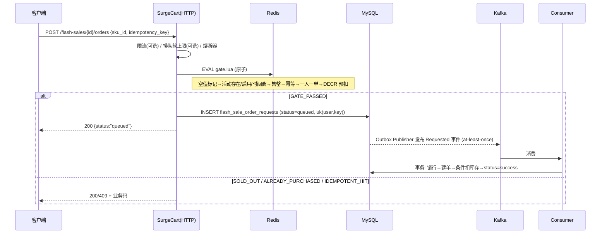

# T5-03 开发知识文档：高并发秒杀业务正确性验证

> 目标读者：没参与本次实验、需要在两周后复现或回答面试提问的人。
> 本文解释「系统凭什么不超卖」「实验凭什么能证明它没超卖」，以及过程中踩到的坑。
>
> 分支：`feat/k8s-t5-03-concurrency-correctness`
> 基线：`ce8d86c8ee0958962cc656d15160f34b10a25ba1`（T5-02 最终提交）
> 实验：2026-11-10 08:25–08:29 UTC，kafka 模式，活动 13/14/15

---

## 1. 任务背景

T5-01 建了 k6 框架、T5-02 验证了只读链路的性能。但秒杀最关键的从来不是 QPS，
而是**并发下的业务正确性**：库存只有 20 件，40 个人同时抢，最后是不是恰好 20 单？
同一个人点 10 次，会不会出 10 单？网络重试，会不会重复扣库存？

T5-03 用真实的 kind 集群（真实 MySQL/Redis/Kafka）+ 真实并发请求 + MySQL 只读核验，
回答三个问题：

1. 不超卖？
2. 一人一单？
3. 请求幂等？

不追求吞吐数字（那是 T5-02），不做故障注入（那是 T5-04）。

---

## 2. 原有秒杀业务架构



关键分层（读源码确认，不是猜的）：

| 层 | 文件 | 职责 |
|---|---|---|
| HTTP/DTO | `api/flashsale/v1/flash_sale.go` | 契约、状态枚举 |
| 编排 | `internal/logic/flashsale/flashsale.go` | CreateOrder、建单+扣库存事务 |
| 闸门 | `internal/logic/flashsale/redis.go` | Lua 预扣、缓存预热/失效/对账 |
| 出队/消费 | `internal/logic/flashsale/consume.go` | 事务内落单、失败分类、重试预算 |
| Outbox | `internal/logic/flashsale/outbox.go` | 领租约、发布、标记 |
| Kafka | `internal/mq/kafka/*`、`kafka_consumer.go` | Producer/Consumer/Lag |
| 启动装配 | `internal/worker/flashsale_runtime.go` | 按 mode 启动 Scanner 或 Kafka 组件 |

---

## 3. 库存扣减流程（两级）

**第一级：Redis 预扣（快，不权威）**

```lua
local remaining = tonumber(redis.call('GET', KEYS[3]))   -- flashsale:stock:{act}:{sku}
if remaining == nil then return 'SKU_NOT_BOUND' end
if remaining <= 0 then markSoldout(); return 'SOLD_OUT' end
local after = redis.call('DECR', KEYS[3])
if after < 0 then redis.call('INCR', KEYS[3]); markSoldout(); return 'SOLD_OUT' end
```

- `DECR` 后回读判负并 `INCR` 回滚，是为了在**库存 key 被外部改坏/并发超发**时仍不出现负值；
- 预扣成功 ≠ 下单成功；入队或消费失败时由调用方补偿（`repair.go`/补偿逻辑）。

**第二级：MySQL 条件扣减（权威）**

```go
// flashsale.go insertOrderInTx
if binding.Sold >= binding.TotalStock { return CodeFlashSaleStockInsufficient }
// 先插订单（唯一约束兜底），再条件扣库存：
UPDATE flash_sale_activity_skus SET sold = sold + 1
 WHERE id = ? AND sold < total_stock
```

- 绑定行先 `SELECT ... FOR UPDATE`，同一 activity×SKU 的并发消费被行锁串行化；
- `WHERE sold < total_stock` + `RowsAffected` 是最后一道防超卖；
- 列类型 `INT UNSIGNED`，负库存在存储层面就被拒绝。

**为什么需要两级**：Redis 把 90% 的无效请求挡在 DB 之外（性能），MySQL 保证正确性
（权威）。Redis 挂了会 fail-closed 快速失败，而不是放行。

---

## 4. Redis Lua 的核心作用

整段闸门在一个 `EVAL` 里完成 6 个判断 + 1 次扣减：

```text
EXISTS null  → 负缓存快速失败
HGETALL activity → status/start/end（UNIX_TIMESTAMP 秒）
时间窗判断
EXISTS soldout
GET idem  → 同指纹返回 IDEMPOTENT_HIT，不同指纹返回 IDEMPOTENT_CONFLICT(12005)
EXISTS bought → 一人一单
DECR stock（带负数回滚）
GATE_PASSED 时原子写 bought + idem 标记
```

**为什么必须用 Lua**：这些判断必须原子。用多条命令会出现在"检查通过"和"扣减"之间被
其他请求插入的窗口（check-then-act 竞态），正是超卖的经典成因。Redis 单线程执行 Lua，
天然串行化。

**标记的 TTL**：`finish - now + grace(60s)`，活动结束后自动清理，不留垃圾。
标记在闸门内写入、在"入队失败/消费失败"时由调用方清除（避免孤儿标记）。

---

## 5. 一人一单的实现

三层：

1. **Redis `bought` 标记**（`flashsale:bought:{act}:{sku}:{user}`）——快路径，挡住 99%；
2. **MySQL 唯一索引** `uk_flash_one_per_user(activity_id, sku_id, user_id)`——最终兜底；
3. **消费侧**命中唯一键时把请求写成 `failed(12004)`，不产生订单、不扣库存。

**并发下的一个真实细节（本次实测）**：闸门命中"已购"后调用 `handleAlreadyPurchased`，
它会查 MySQL 区分"真已购"与"崩溃窗口孤儿标记"（标记写上但请求行没落库）。
若首个请求还在 `queued`（尚未落单），后续请求会被判成孤儿标记并自愈放行。
于是 10 个并发请求全部拿到 `200/queued`，最后由唯一索引在消费阶段拒掉 9 个（12004）。
**正确性没破**（1 单、扣 1 次），但多了一次入队/消费，属于可优化点（见报告 §9.2）。

---

## 6. Outbox 与 Kafka 链路

- 没有独立 outbox 表：`flash_sale_order_requests` 本身扩展为 Outbox
  （migration `..._flash_sale_request_outbox`），新增 `published_at / publish_claim_token /
  publish_lease_until / publish_attempts / next_publish_at / published_partition/offset`；
- 发布语义 **at-least-once**：`published_at` 只能由"Broker 已确认"的结果写入，禁止先标记后发布；
  租约过期可被其他实例重新领取；
- 消费幂等的边界**不是 event_id**，而是 **MySQL 请求行状态**（事务内锁行读取）：
  `status != queued` 一律跳过（`duplicate`），这是重复投递/offset 提交失败重投的唯一闸门；
- 因此"重复消息"不会产生重复订单，只会被记成 duplicate 并提交位移。

本次实测：三个活动的 `published_at IS NULL` 行数为 0，消费组 `LAG=0`。

---

## 7. 消费幂等：事务内的四道闸门

```go
// consume.go consumeLockedRequestInTx
1. if r.Status != queued → duplicate，跳过（幂等闸门）
2. if r.RetryCount > 预算 → dead
3. resolveSku：快照价格/名称（不信任客户端与消息）
4. SavePoint → insertOrder(唯一索引兜底) → 条件扣库存 → status=success
   任一步失败 → RollbackTo(SavePoint) → 写 failed 终态
```

"订单与库存同生共死"靠 SAVEPOINT：建单失败就回滚到保存点，绝不出现"有订单没扣库存"
或"扣了库存没订单"。

---

## 8. 本次实验设计

| 实验 | 目的 | 活动/库存 | 并发 | 账号 | 幂等键 |
|---|---|---|---:|---|---|
| A 库存竞争 | 40 抢 20 会不会超卖 | 13 / 20 | 40 VU | 40 个独立用户 | 各自唯一 |
| B 一人一单 | 同一用户 10 并发 | 14 / 5 | 10 VU | 1 个共享账号 | 每 VU 唯一 |
| C 请求幂等 | 同一请求 10 并发 | 15 / 5 | 10 VU | 1 个共享账号 | **全部相同** |

设计要点：

- **请求数必须确定**：所有实验都是"每个 VU 跑 1 次"（`per-vu-iterations`），
  不用 `stages`（按时长压测会发出不确定数量的请求，无法与库存精确对照）；
- **A 的请求数必须 > 库存**：40 > 20，才能观察"超出部分被正确拒绝"；
- **B/C 用不同维度**：B 变幂等键（测一人一单）、C 固定幂等键（测请求幂等），
  否则两条不变量会混在一起，无法归因；
- **必须等终态**：提交后轮询 `GET /flash-sales/{id}/orders/result`，直到 success/failed/dead。

---

## 9. k6 并发是怎么产生的

```js
export const options = {
  scenarios: {
    once: { executor: 'per-vu-iterations', vus: 10, iterations: 1, maxDuration: '5m' },
  },
};
```

- `vus` 个独立 JS 运行时同时启动，各自发 1 个 POST → **真正的并发**（不是 for 循环串行）；
- 用户选择：`data.users[(vu.idInTest - 1) % users.length]`；
  `FLASH_SHARED_USER=true` 时所有 VU 取 `users[0]`；
- 幂等键：默认 `runId-k6-{vu}-{iter}`；`FLASH_FIXED_KEY` 给定时所有 VU 用同一个字面量；
- 逐条日志 `FLASH_TRACE vu=.. user=.. key=.. http=.. code=.. outcome=.. data_status=..`，
  这是"逐请求证据"，可与 MySQL 行一一对照。

**陷阱**：`import { execution } from 'k6/execution'` 拿到的是 `undefined`
（该模块是默认导出），必须 `import exec from 'k6/execution'`。

---

## 10. 测试数据如何隔离

1. 每个实验一套独立 **商品+SKU+活动**（`prepare-data.js` 创建，前缀 `k6t503`）；
2. 用户名 = `前缀 + run短哈希 + u序号`，不同 run 不重名（前提：哈希不能退化，见 §14.4）；
3. 不复用任何历史活动（T3-02 的 1–6 号活动、T5-02 的商品都没碰）；
4. 不做删除/清库/重置 Redis DB/删 Topic；
5. 实验前记录基线（活动 6 / 绑定 6 / 订单 2 / 请求 2），实验后确认只增不改。

本次产生的副作用（如实记录）：新增活动 7–15、商品/SKU 5–13、秒杀订单 22 笔
（20+1+1）、请求行 31 条、测试用户 122 个（含一次失败尝试）。

---

## 11. 如何核验库存正确性

**权威来源是 MySQL**，不是 Redis：

```sql
SELECT total_stock, sold, total_stock - sold AS remaining
FROM flash_sale_activity_skus WHERE activity_id = ? AND sku_id = ?;
```

判定：
- `sold <= total_stock`；
- `remaining >= 0`；
- `COUNT(flash_sale_orders WHERE activity_id=? AND sku_id=?) = sold`。

再与 Redis `GET flashsale:stock:{act}:{sku}` 对照（派生缓存应与权威值一致）。

本次：A 20/20/0，B 5/1/4，C 5/1/4；Redis 0/4/4，完全一致。

---

## 12. 如何核验一人一单

```sql
SELECT COUNT(*) FROM (
  SELECT activity_id, sku_id, user_id FROM flash_sale_orders
  WHERE activity_id = ? GROUP BY activity_id, sku_id, user_id HAVING COUNT(*) > 1
) t;
```

结果必须为 0。辅以：`COUNT(*) orders` 与 `COUNT(DISTINCT user_id)` 相等。

本次：A 20 单 / 20 用户；B、C 各 1 单 / 1 用户；违例数 0。

---

## 13. 如何核验请求幂等

```sql
-- 同一 (user, idempotency_key) 不得出现多行请求
SELECT COUNT(*) FROM (
  SELECT user_id, idempotency_key FROM flash_sale_order_requests
  WHERE activity_id = ? GROUP BY user_id, idempotency_key HAVING COUNT(*) > 1
) t;
-- 同一活动请求数 / 不同键数 / 终态分布
SELECT COUNT(*), COUNT(DISTINCT idempotency_key), SUM(status=1), SUM(status<>1)
FROM flash_sale_order_requests WHERE activity_id = ?;
```

本次 C：10 个相同幂等键的并发请求 → 1 条请求行、1 个 distinct key、1 单，库存只扣 1。

---

## 14. 实验遇到的问题（全部真实发生）

### 14.1 时区缺陷：活动建好就"已结束"（最重要）

**现象**：按 UTC(RFC3339 `Z`) 创建 2 小时窗口的活动，40 个请求全部 `404/12001`。

**定位过程**：
1. 先确认 MySQL 里活动存在、`status=1`、`UNIX_TIMESTAMP(end_time) > NOW()`；
2. 用 `redis-cli MONITOR` 观察应用对新建活动的实际命令，看到
   `Del flashsale:activity:N` + `SetEX flashsale:null:N 1 60` → 应用执行了"失效"分支；
3. 读 `syncActivityCache`：`if a.Status != enabled || a.EndTs <= now { invalidate }`；
4. 换成 12 小时窗口再建一次，同一路径写出 `HSet ... end=1794313441`，
   而真实结束时刻是 `1794342241` → **差 28800 秒 = 8 小时**。

**根因**：应用把 MySQL 会话时区设为 `dashboard.timezone=Asia/Shanghai`，
而写 DATETIME 时驱动按 UTC 格式化；UTC 墙钟被当成 +08:00 解读，`UNIX_TIMESTAMP` 少 8 小时。
2 小时窗口的活动在闸门看来已结束 8 小时 → 预热即失效 → 全部 12001。

**解决（测试侧，不改业务代码）**：`prepare-data.js` 按 Asia/Shanghai 墙钟提交时间
（新增 `FLASH_TZ_OFFSET_SECONDS`，默认 28800），并在创建后用 SQL 反查 `in_window=1` 再开始实验。

**教训**：容器、DB、业务三者的"本地时间"可能各不相同；任何时间敏感的实验，
**必须用 SQL 在服务端会话时区下验证时间窗**，而不是相信 API 回显的字符串。

### 14.2 `k6/execution` 导入错误

`import { execution } from 'k6/execution'` → 运行期 `Cannot read property 'vu' of undefined`，
40 个 VU 全部空转（只发出 setup 的 80 个请求）。改成默认导入后正常。

### 14.3 新开关没进 run.ps1 白名单 → 静默退化

`FLASH_EXECUTOR=once` 没被透传，脚本按 `stages` 跑了 165s 持续压测（请求数不可控），
只能终止。此后把所有 `FLASH_*` 开关加进白名单，并在场景里打印
`executor/users/vus/shared_user/fixed_key`，让形态在日志第一屏可见。

### 14.4 `shortRunId` 哈希退化

FNV-1a 在 JS 里 `hash * 0x01000193` 超过 2^53 丢精度，实测对 `t503-a-data` 退化成 `000000`，
不同 run 可能拿到同一段用户名 → 用户隔离失效。改为"模 36^6"的多项式哈希。

### 14.5 脱敏正则漏掉含数字的键名

`^([A-Za-z_]*(PASSWORD|...))` 匹配不到 `K6_TEST_PASSWORD`（含数字 6），密码被原样打印到终端。
改为 `[A-Za-z0-9_]*`。

### 14.6 `K6_DATA_MARKER` 解析失败

k6 的 console 输出是结构化日志行（`time=... msg="K6_DATA_MARKER {...}"`），
原来按"行首匹配"解析永远失败。改为"行内查找标记 → 提取最后一个 JSON 对象 → 还原 `\"` 转义"。

### 14.7 测试用户密码不一致导致 setup 失败

同一 `RUN_ID` 复跑时若换了 `K6_TEST_PASSWORD`，会先命中"用户名已存在(2001)"再登录失败(2002)。
框架给出的报错很明确，处理办法是换 `RUN_ID`（本次就是这么做的）。

---

## 15. 关键技术决策

| 决策 | 选择 | 放弃的方案 | 原因 |
|---|---|---|---|
| 并发形态 | `per-vu-iterations`（每 VU 1 次） | `stages` 持续压 | 正确性实验需要**确定**的请求数，才能与库存精确对照 |
| 并发数 | A=40、B/C=10 | 100+ | 单节点 kind；40 已足够制造真实竞争，且失败可解释 |
| 账号维度 | A 多用户 / B、C 共享单用户 | 全多用户 | 一人一单必须同用户并发 |
| 幂等维度 | B 变键 / C 固定键 | 只做一种 | 两类语义不同，混在一起无法归因 |
| 权威来源 | MySQL | Redis / HTTP 响应 | Redis 是派生缓存，HTTP 只表示"受理" |
| 时间窗 | +08 墙钟提交 + SQL 复核 | 相信 API 回显 | 实测发现 -8h 偏差 |
| 消费模式 | 只做 kafka | 切 db_scanner | 切换需改 K8s ConfigMap + 重启，超出授权范围 |
| 缺陷处理 | 记录证据、不修业务代码 | 顺手改 Go | 任务明确禁止；且修复需独立评估 |

---

## 16. 如何复现全部实验

```powershell
# 0) 前置：kind 集群 + 应用 Ready + 端口转发
kubectl -n surgecart port-forward svc/surgecart 18000:8000
kubectl -n monitoring port-forward svc/prometheus 9090:9090

# 1) 准备三套数据（需要管理员凭据，从 Secret 读入当前会话，不落盘）
#    注意 FLASH_START_OFFSET/END_OFFSET 是相对现在的秒数；默认按 +08 墙钟提交
$env:ADMIN_USERNAME='admin'   # 密码从 Secret 注入到环境变量
foreach ($s in @('t503-a2-data','t503-b2-data','t503-c2-data')) {
  $env:FLASH_TOTAL_STOCK = if ($s -like '*a2*') {'20'} else {'5'}
  test/k6/scripts/run.ps1 -Scenario prepare-data -RunId $s -BaseUrl http://host.docker.internal:18000
}
# 记录 K6_DATA_MARKER 中的 activity_id / sku_id，并用 §14.1 的 SQL 复核 in_window=1

# 2) 实验 A/B/C（见报告 §4）
$env:K6_TEST_PASSWORD='<测试账号密码>'
$env:FLASH_EXECUTOR='once'; $env:FLASH_ITERATIONS='1'; $env:FLASH_VERIFY='true'; $env:FLASH_TRACE='true'

# A：40 用户
$env:ACTIVITY_ID='<A活动>'; $env:SKU_ID='<A SKU>'; $env:FLASH_USERS='40'; $env:FLASH_VUS='40'
test/k6/scripts/run.ps1 -Scenario flashsale-order -RunId t503-a-c1 -BaseUrl http://host.docker.internal:18000

# B：1 用户 10 并发
$env:ACTIVITY_ID='<B活动>'; $env:SKU_ID='<B SKU>'; $env:FLASH_USERS='1'; $env:FLASH_VUS='10'; $env:FLASH_SHARED_USER='true'
test/k6/scripts/run.ps1 -Scenario flashsale-order -RunId t503-b-c1 ...

# C：1 用户 + 固定幂等键
$env:ACTIVITY_ID='<C活动>'; $env:SKU_ID='<C SKU>'; $env:FLASH_FIXED_KEY='t503-c-fixed-key-1'
test/k6/scripts/run.ps1 -Scenario flashsale-order -RunId t503-c-c1 ...

# 3) 核验：执行 docs/reports/t5-03-high-concurrency-correctness/raw/business-verification.md 里的 SQL
```

复现门槛：
- `checks rate==1` 且 `k6_request_errors=0`（否则说明框架或环境坏了）；
- 每个活动的 `queued` 必须收敛到 0（否则等消费或查 Lag）；
- `dup_one_per_user = 0`、`dup_idem = 0`。

---

## 17. 结果如何解释

| 结论 | 证据 | 不能过度解读为 |
|---|---|---|
| 不超卖 | A：40 请求/库存 20 → 20 单，sold=20，remaining=0 | 不证明 1000 并发下也不超卖（未测） |
| 一人一单 | B：10 并发 → 1 单，唯一索引违例 0 | 不证明 HTTP 层会返回 409（实际返回 200/queued） |
| 请求幂等 | C：10 同键 → 1 请求行 + 1 单 | 不覆盖"同键不同内容"(12005) |
| 异步收敛 | queued 残留 0，LAG=0 | 不证明故障注入后仍收敛（T5-04） |
| Redis/MySQL 一致 | stock key 与 remaining 相等 | 不证明任意时刻都一致（对账有 60s 周期） |

---

## 18. 面试可展开的知识点

**并发与一致性**
1. 为什么"先查库存再扣减"会超卖？用 Lua 原子脚本怎么消除这个窗口？
2. Redis 预扣 + MySQL 条件扣减的两级设计，各自解决什么问题？Redis 挂了怎么办（fail-closed）？
3. `UPDATE ... WHERE sold < total_stock` + `RowsAffected` 为什么能防超卖？行锁在这里起什么作用？
4. 库存字段用 `INT UNSIGNED` 的意义（数据库层拒绝负值）。
5. 一人一单为什么还要数据库唯一索引？只用 Redis 标记会怎样（重启/丢数据/多实例）？

**消息与幂等**
6. Outbox 模式解决什么问题？为什么 `published_at` 必须由 Broker 确认后写？
7. at-least-once 下消费端如何做到幂等？为什么用"请求行状态"而不是 event_id 去重？
8. 为什么"建单 + 扣库存"要放同一个 SAVEPOINT？失败后的 failed 终态怎么写才不留半成品？
9. 幂等键为什么是 `(user_id, idempotency_key)`？同键不同内容为什么返回冲突而不是覆盖？

**测试与验证**
10. 如何证明"没有超卖"？为什么必须查 MySQL 而不是相信 HTTP 200？
11. `queued` 与 `success` 的区别？为什么不能把受理当成功？
12. 如何设计一个"请求数确定"的并发实验？`per-vu-iterations` 与 `stages` 的区别。
13. 时间窗实验为什么要用 SQL 在服务端会话时区下复核？（本次的 -8h 缺陷就是反例）
14. 观察到"10 个并发都返回 200"时，如何判断是系统错了还是符合设计？（查最终订单 + 失败码）

**排障**
15. `redis-cli MONITOR` 能回答什么问题？（应用到底发了什么命令，比读代码更直接）
16. 如何判断"缓存没预热"而不是"活动不存在"？（负缓存 key、HGETALL、invalidation 日志）

---

## 19. 已知限制与未验证内容

| 项 | 状态 | 说明 |
|---|---|---|
| kafka 模式三条不变量 | VERIFIED | 见报告 §6/§8 |
| db_scanner 模式 | NOT_VERIFIED | 需改 ConfigMap 并重启应用（超出授权） |
| 幂等键冲突 12005 | NOT_VERIFIED | 未构造"同键不同内容" |
| dead / DLQ / 重试预算 | NOT_VERIFIED | 属 T5-04 |
| 更高并发（100/500 VU） | NOT_VERIFIED | 单节点资源有限，且非本任务目标 |
| 多副本一致性 | NOT_VERIFIED | 当前单副本 |
| 时区缺陷修复 | NOT_IMPLEMENTED | 仅记录与规避，未改业务代码 |
| 一人一单自愈放大 | 已观察，未修复 | 不变量成立，属体验/效率问题 |
