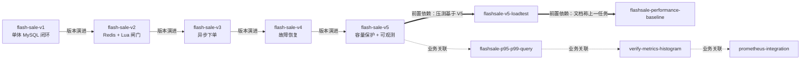
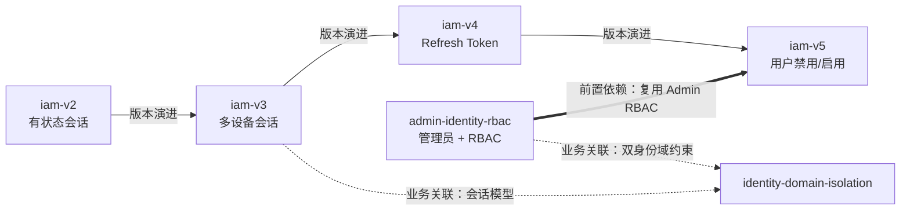
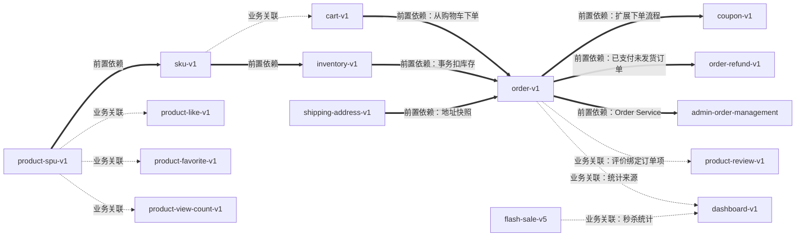
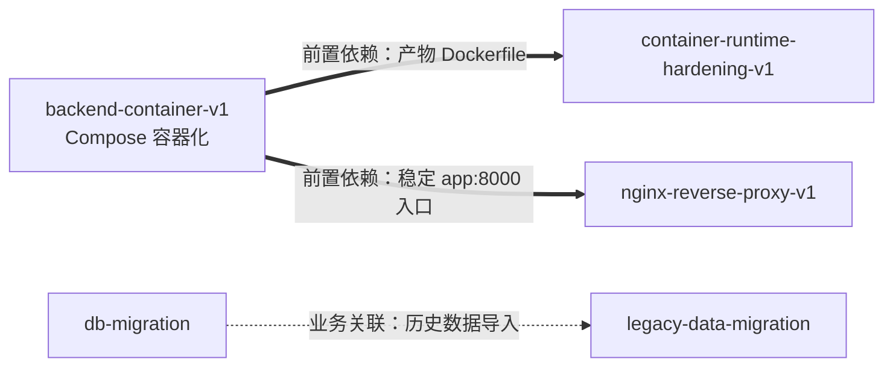
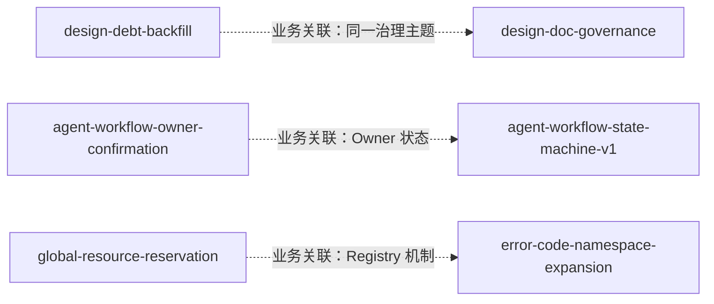

# Task 关系图

本文件只画**有文档或 Git 证据支持**的关系。名称相似但没有证据的 Task 不连线。

## 1. 图例

| 箭头 | 含义 | 判定标准 |
|---|---|---|
| `-->` 细实线，标注“版本演进” | 已证实的同一业务版本演进 | 后一版 `task.md` 的 Goal 明确引用前一版或“在 V(n-1) 基础上” |
| `==>` 粗实线，标注“前置依赖” | 已证实的前置依赖 | 后一任务 Goal/Context 明确依赖前一任务的产物、服务或数据模型 |
| `-.->` 虚线，标注“业务关联” | 仅存在业务关联 | 同域、共享模块或数据，但不能证明先后依赖 |
| 不画箭头 | 尚待核实的关系 | 只有间接线索（如数据库表、命名），未在任务文档中显式声明；集中列在 §7 |

**版本演进不等于归档或替代**：每个版本的交付状态独立判断；旧版本仍保留原目录、原 Evidence 与原分支。2026-10-18 迁移只改变物理分类目录，不改版本关系与 State。

## 2. 秒杀域

证据：

- V2 Goal：“在秒杀 V1（单一 MySQL 已证明正确性）基础上引入 Redis + Lua”。
- V3 Goal：“在秒杀 V2（Redis + Lua 同步落单，已证明正确性）基础上引入异步下单”。
- V4 Goal：“在秒杀 V3（Redis 闸门 + MySQL 出队表 + goroutine+ticker 消费者）已证明异步下单正确性的基础上”。
- V5 Goal：“在秒杀 V1-V4 已证明「异步下单 + 故障恢复」正确性的基础上”。
- `flashsale-performance-baseline/task.md`：“环境版本事实（来自上一任务 `flashsale-v5-loadtest` 交付记录）”。
- p95 / Histogram / Prometheus 之间只有共享指标与配置的关系，任务文档未声明先后依赖，因此用虚线。

注意：`flash-sale-v3` 的 `delivery=PASS` 只存在于未合并分支 `origin/feat/flash-sale-v3`，`develop` 上仍为 `NOT_RUN`；这不影响“V3 → V4”的技术演进关系，但 V3 的交付状态按 [owner-decisions](owner-decisions.md#3-flash-sale-v3-的受控集成) 单独处理。

## 3. 身份与权限域

证据：

- `iam-v3/task.md` 的当前会话模型直接来自 `iam-v2` 建立的有状态会话（`iam:session:{sid}`）。
- `iam-v4/task.md`：“在现有「无状态 JWT access token + Redis 有状态会话」之上”，并明确引用 IAM V3 提交 `0291413`。
- `iam-v5/task.md`：“复用现有 JWT、Redis 会话、Admin RBAC 与 GoFrame 分层”。
- `identity-domain-isolation/task.md` 要求前台 `users` / 后台 `admins` 两套凭据、Token type、session 前缀与中间件隔离；`admins` 表由 `admin-identity-rbac` 引入，但任务文档未点名该 Task，因此只画业务关联。

## 4. 商品、库存与交易域

证据：

- `sku-v1` Goal：“在已实现的商品 SPU 之上建立「商品 1 — N SKU」关系”。
- `inventory-v1` Goal：“在已实现的 SKU 之上，基于 `sku_id` 建立独立库存模型”。
- `order-v1` Goal：“从购物车勾选项或直接购买创建订单”“事务内写订单 + 写订单项 + 扣库存”“保存收货地址快照”。
- `coupon-v1` Goal：“普通订单下单可选一张自己的券……在现有下单流程内扩展”。
- `order-refund-v1` Goal：“已支付未发货普通订单”的仅退款闭环。
- `admin-order-management` Goal：“基于现有 GoFrame、MySQL、Order Service、Admin JWT 与 RBAC”。
- `cart-v1` 需要有效 SKU，但任务文档未声明依赖 `sku-v1`，因此只画业务关联。

## 5. 容器与基础设施

证据：

- `container-runtime-hardening-v1/task.md` 审计现有多阶段 `Dockerfile`（`builder golang:1.23-alpine → runtime alpine:3.20`，当前 root 运行），并补非 root、liveness/readiness、优雅退出。
- `nginx-reverse-proxy-v1` 的前置由 `backend-container-v1` Goal 声明：“为后续独立的 Nginx V1 任务提供稳定的 `app:8000` 服务入口”。
- `legacy-data-migration` 与 `db-migration` 只共享数据库 schema 事实，不构成先后依赖。

## 6. 文档治理与 Workflow 治理（仅业务关联）

说明：

- `design-debt-backfill` 补历史模块的长期 Design；`design-doc-governance` 建立 Design Impact 与四者一致的治理机制。任务文档未互相引用，不画演进箭头。
- 两个 `agent-workflow-*` 任务都无 State、`delivery.md` 为占位，无法证明先后或替代关系。
- `global-resource-reservation` 与 `error-code-namespace-expansion` 同属 Registry 主题，但没有交付证据证明依赖。

## 7. 尚待核实（不画箭头）

以下关系只有间接线索，未在任务文档中显式声明；需要 Owner 或后续 T1 任务核实：

1. `identity-domain-isolation` 与 `admin-identity-rbac` 的严格先后（`admins` 表来源可追溯，但任务文档未点名）。
2. `flashsale-p95-p99-query` 与 `verify-metrics-histogram` 的先后（都操作 Histogram，但未互相引用）。
3. `agent-workflow-owner-confirmation` / `agent-workflow-state-machine-v1` 与当前 V4 框架文档的承接关系（无交付记录）。
4. `categories-v1`、`error-code-namespace-expansion`、`global-resource-reservation` 的代码/机制已存在于 `develop`，但没有本任务的交付证据，不能据此认定任务完成。

## 8. 使用约束

- 本图用于理解与检索，不用于证明交付完成；交付状态以 `state.yaml` + Git Evidence 为准。
- 不因本图存在箭头就合并、归档或删除任何 Task。
- 新增版本时，先在新 Task 的 `task.md` 写明与旧任务的引用和 Evidence SHA，再更新本图。
